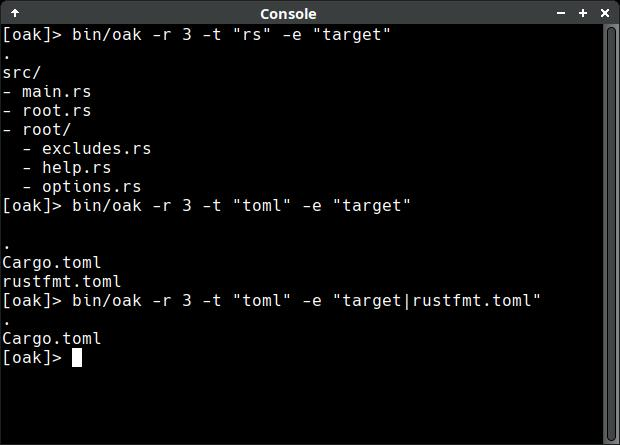

# oak
oak displays files and folders in a tree structure

## features
- display files and folders in a tree structure
- exclude specific paths
- filter files by extension
- limit directory depth
- show help and usage options

## tests
- ok on amd64 Linux/Windows

## license

Copyright (c) 2026 alexander14k28@gmail.com

See [LICENSE](LICENSE) for the license governing this project.
